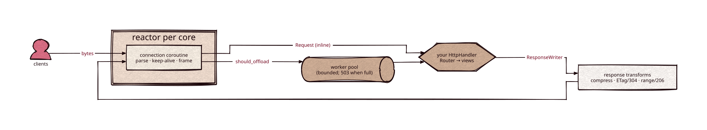

# http

Part of [Kronuz C++ Libraries](https://github.com/Kronuz/cpp-libraries), a collection of small, reusable C++ libraries.

[](https://github.com/Kronuz/http/actions/workflows/ci.yml)
[](LICENSE)


An HTTP/1.1 application framework for C++20 on standalone Asio coroutines. Your app
implements one method, `handle(Request, ResponseWriter)`; the framework handles
sockets, parsing, keep-alive, negotiation, compression, and backpressure.

Buffered response decorators can distinguish `response_started()` from `response_ended()`: setting a status or writing bytes does not complete a response; Asio reports completion only after `end()` succeeds. The new query defaults to the historical started approximation for existing custom `BufferedResponse` writers. Override it for accurate middleware error mapping. This is source compatible but extends a virtual interface: rebuild all consumers together rather than mixing header revisions. It does not indicate confirmed network delivery.

The server framework is header-only. Optional bounded HTTP clients share one parser across POSIX and Asio drivers, with TLS and connection reuse when enabled; their POSIX and TLS targets contain compiled code.



## ✨ Highlights

- 🔌 **One seam**: the handler never sees the parser, the socket, or the event loop.
- 🧵 **Shared-nothing reactors**: one Asio `io_context` per core, with a bounded worker
  pool for blocking handlers; past its limit, requests get `503` instead of a stall.
- 🌊 **Bounded memory for any body**: stream request bodies to a `BodySink` chunk by
  chunk, and stream responses with backpressure.
- 🤝 **Batteries**: a radix-tree `Router`, content negotiation, zstd/gzip compression,
  ETags with `304`, and byte ranges with `206`.
- 🔒 **Optional TLS**, connection caps, and per-request deadlines; OpenSSL is linked
  only when you use the TLS adapter.
- 🗣️ **Custom methods**: built on [http-parser](https://github.com/Kronuz/http-parser),
  so verbs like `COUNT` or `RESTORE` parse.

## 📦 Installation

Requires a C++20 compiler and CMake 3.16 or newer. Asio and the Kronuz dependencies
are fetched at configure time. CI builds it on Linux (x86_64, arm64), macOS (arm64,
x86_64), and FreeBSD, plus ASan, UBSan, and TSan builds.

```cmake
include(FetchContent)
FetchContent_Declare(http
  GIT_REPOSITORY https://github.com/Kronuz/http.git
  GIT_TAG        main)
FetchContent_MakeAvailable(http)

target_link_libraries(my_app PRIVATE http::http)
```

## 🚀 Quick start

```cpp
#include "http_asio.h"
#include "http_router.h"

#include <chrono>
#include <thread>

struct App : http::HttpHandler {
	http::Router router;
	App() {
		router.route("GET", "/hello/:name", [](const http::Request&, http::ResponseWriter& resp, const http::Params& p) {
			resp.send(200, "hello, " + std::string(p.get("name")) + "\n");
		});
	}
	void handle(const http::Request& req, http::ResponseWriter& resp) override { router.handle(req, resp); }
};

int main() {
	App app;
	http::HttpAsioService service(app, /*reactors=*/4, /*workers=*/2, /*queue_limit=*/256);
	service.start(8080);   // curl localhost:8080/hello/world
	std::this_thread::sleep_for(std::chrono::minutes(1));
	service.stop();
}
```

[`examples/kv_store.cc`](examples/kv_store.cc) is a complete REST key/value app,
including a streamed response and a streamed request body:

```sh
cmake -B build -DCMAKE_BUILD_TYPE=Release && cmake --build build
./build/kv_store 8080 &
curl -XPUT localhost:8080/kv/greeting -d 'hello'
curl localhost:8080/kv/greeting
```

## 🎯 When to use it

For clients without the server dependency graph, see [HTTP clients](docs/CLIENTS.md). Configure `HTTP_BUILD_SERVER=OFF` and `HTTP_BUILD_CLIENTS=ON` for a POSIX client profile without Asio, reactor, compressors or OpenSSL. Client targets are disabled by default so existing server consumers do not build an unused compiled client. Enable `HTTP_BUILD_CLIENT_ASIO` or `HTTP_BUILD_CLIENT_TLS` for the corresponding coroutine drivers. [client_get.cc](examples/client_get.cc) shows a numeric-endpoint request under one deadline.

- ✅ A C++ service that needs a solid HTTP/1.1 front: REST APIs, search or storage
  servers, admin endpoints.
- ❌ HTTP/2, HTTP/3, or WebSockets: not implemented.

## 📚 Documentation

- [ARCHITECTURE.md](ARCHITECTURE.md): the two layers, why the seam has this shape,
  the request lifecycle, and the response transforms.
- [docs/TRANSPORT.md](docs/TRANSPORT.md): deferred replies, TLS, connection caps,
  request deadlines, and early rejections.
- [docs/OWNED_STREAMING.md](docs/OWNED_STREAMING.md): owned response streaming.
- [docs/AUDIT.md](docs/AUDIT.md): transport audit findings, measured before and after.
- [AGENTS.md](AGENTS.md): file map, invariants, and dependencies.
- [prism](https://github.com/Kronuz/prism): a full app server built on this library.

## 🛠️ Building and testing

```sh
cmake -B build -DCMAKE_BUILD_TYPE=Release && cmake --build build
ctest --test-dir build
```

## 🤝 Contributing

Issues and pull requests are welcome. Read [AGENTS.md](AGENTS.md) first. CI must
pass on every platform.

## 📄 License

MIT, Copyright (c) 2026 Germán Méndez Bravo. See [LICENSE](LICENSE).
